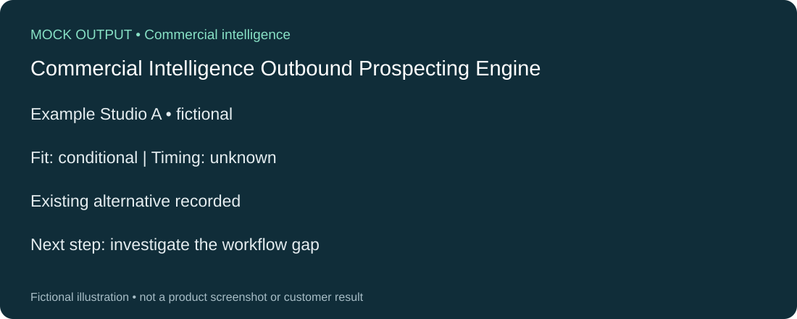

# Commercial Intelligence Outbound Prospecting Engine

Company research that separates product fit, buying signals, counterevidence and unknowns.

## Problem and intended user

Salespeople need to decide which accounts deserve attention. A company name or an animation-industry label does not establish need, timing or a reason to buy.

Salespeople and business-development teams preparing account research.

## How it works

**Inputs:** Seller website and target-company domains, with research and API spending limits.

A manually started n8n workflow researches the seller and target companies, checks quoted source passages and dates, then assesses product relevance and existing alternatives. Results include questions, holds and coverage limitations. Google Sheets provides a review destination; Supabase stores research history.

**Outputs:** See the [illustrative example](example-output.md).

**Tools:** n8n, Apify, OpenAI, Google Sheets and Supabase. Earlier project variants also explored other discovery providers; those variants are not treated as connected features here.

## Decisions behind the design

- Treat industry fit as a reason to research, not a reason to claim someone needs the product.
- Keep existing tools and contradictory evidence visible, even when they weaken the sales case.
- Prefer a clear hold over a padded prospect list.
- Limit further research when the evidence or expected value is weak.

These choices show commercial qualification judgment. They do not establish purchase intent or sales results.

## Commercial value

Makes the reasoning behind an account recommendation reviewable. It is designed to reduce repetitive research and prevent weak evidence from becoming a sales claim. Time saved, pipeline generated and revenue impact have not been measured.

## Current status and evidence

A bounded account-research flow has live integration evidence. The newer adaptive follow-up extension is locally mock-tested; its live research quality remains unverified.

On 30 October 2026, a live five-target run completed research and output delivery using the external providers. On 4 November, a cached-evidence comparison made 14 real inference calls across two runs and delivered both reports to Sheets. The newer adaptive extension passed 72 account tests and 693 regression tests, plus an actual local n8n execution using simulated providers. Those simulated readbacks do not prove live delivery of the extension.

## Limitations and next steps

The small live comparison found more specific assessments for two accounts, mixed results elsewhere and no verified buying signals. Source recall, business-unit scope and final question quality still need improvement. A five-account controlled benchmark against independent manual research remains pending. The system does not send outreach.

## Explore

- [High-level architecture](architecture.md)
- [Clearly labelled mock output](example-output.md)
- [90-second demo script](demo-script.md)

The illustration above is a recreated mock visual, not a screenshot or a result measurement.

[Back to portfolio](../README.md)
