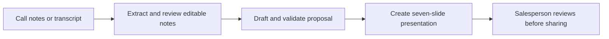

# High-level architecture

This is a conceptual view. It omits node configuration, API endpoints, prompts and implementation rules. The project README distinguishes live-tested stages from extensions tested with simulated providers.
